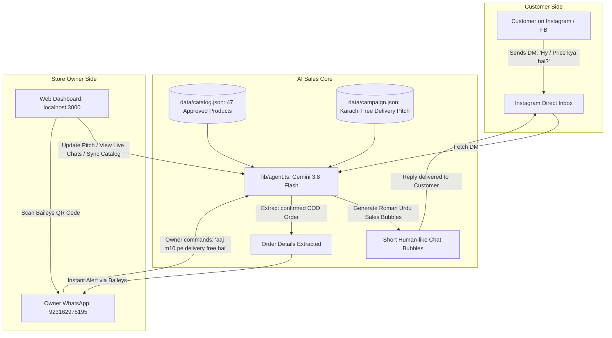

# 🛍️ Dastiyab Store — AI Instagram & WhatsApp Sales Agent

An intelligent, full-stack AI Sales & Automation Agent built specifically for **Dastiyab Store** (`dastiyabstore.com`, Karachi, Pakistan).

The agent acts as a 24/7 human-like salesperson on Instagram & Facebook DMs: it answers customer questions in natural Roman Urdu, recommends verified in-stock products from the store catalog, highlights special offers (such as **Karachi Free Delivery**), collects Cash on Delivery (COD) order details, and instantly sends order receipts to the store owner's WhatsApp via Baileys!

---

## 📑 Table of Contents
1. [System Architecture & Workflow Diagram](#-system-architecture--workflow-diagram)
2. [Key Features](#-key-features)
3. [Project Directory & File Guide](#-project-directory--file-guide)
4. [Tech Stack](#-tech-stack)
5. [Setup & Installation Guide](#-setup--installation-guide)
6. [WhatsApp Pairing Guide](#-whatsapp-pairing-guide)
7. [AI Sales Rules & Store Policies](#-ai-sales-rules--store-policies)
8. [Live DM Inbox & Simulator](#-live-dm-inbox--simulator)
9. [Vercel Deployment & Crons](#-vercel-deployment--crons)
10. [Official Meta Graph API (Next Steps)](#-official-meta-graph-api-next-steps)

---

## 📊 System Architecture & Workflow Diagram



---

## 🌟 Key Features

### 1. 🤖 Human-Like AI Salesperson (`lib/agent.ts`)
* **Model:** Powered by Google's latest **`gemini-3.8-flash`** via OpenAI-compatible endpoint.
* **Natural Roman Urdu:** Speaks like a helpful Pakistani shopkeeper (*"Walaikum Assalam! Dastiyab Store mein welcome!..."*).
* **Multi-Bubble Messages:** Doesn't send robotic walls of text; breaks responses into 2–3 short, natural chat bubbles with natural typing pauses.
* **COD Order Extractor:** Automatically extracts Customer Name, Mobile Number, City, and Address once confirmed.

### 2. 📲 Real-Time WhatsApp Alerts & Control (`lib/whatsapp.ts`)
* **Zero Paid API Fees:** Uses Baileys (`@whiskeysockets/baileys`) for WhatsApp Web connection.
* **1-Click Dashboard QR Scan:** Renders live pairing QR code right on the web dashboard (`http://localhost:3000`).
* **Owner Commands via WhatsApp:** The store owner can text commands in WhatsApp ("Message yourself" / Note to Self or direct chat):
  * `"status"` — returns current promo, active products, and recent orders.
  * `"bhai aaj ads chalaye hain to m10 pe delivery free kardo"` — AI understands naturally and updates sales pitch immediately!

### 3. 💬 Live Instagram Inbox & Chat History (`app/components/LiveChatInbox.tsx`)
* **Two-Pane Messenger Interface:** Left panel shows customer threads with unread indicators and "Order Confirmed" badges; right panel displays full chat history.
* **📋 1-Click Copy for Instagram:** Easily copy the AI's response with a single click and paste directly into Instagram DM.
* **🧪 Test Customer Chat Simulator:** Type any test inquiry (or click quick presets like *"M10 wholesale rate?"*, *"Karachi delivery charges?"*) to test the AI's live responses.

### 4. 📦 Filtered Product Catalog (`data/catalog.json`)
* **Strictly 47 Core Products:** Includes high-demand gadgets, earbuds (M10, M19, M28, Air31), neckbands, rechargeable mini fans, crystal lamps, and 6-in-1 makeup sets.
* **No Clothing / Nightsuits:** All clothing, sleepwear, and apparel are completely filtered out per store policy.
* **Wholesale Policy:** Wholesale/vendor inquiries are quoted the standard retail catalog price (no special wholesale discounts).

### 5. 📢 Dynamic Campaign Manager (`app/components/CampaignCard.tsx`)
* Change delivery fees, active offers, or promotional rules in natural language or via a direct editable announcement box. Updates apply across all AI conversations immediately.

### 6. 🔄 Automated Daily Catalog & Price Sync (`app/api/cron/sync-catalog`)
* Re-scrapes `dastiyabstore.com/shop` daily to detect price changes, out-of-stock items, or new products, and sends a WhatsApp summary to the owner.

---

## 📁 Project Directory & File Guide

```
├── app/
│   ├── api/
│   │   ├── campaign/route.ts         # GET/POST: Update store promo rules & pitch
│   │   ├── catalog/sync/route.ts     # POST: Manual catalog scraper trigger
│   │   ├── conversations/route.ts   # GET/POST: Retrieve chat threads, manual owner replies & simulation
│   │   ├── cron/
│   │   │   ├── check-dms/route.ts    # Vercel Cron (2 min): Check DMs, reply, extract COD orders
│   │   │   └── sync-catalog/route.ts # Vercel Cron (Daily 03:00 PKT): Shop scraper & price check
│   │   ├── health/route.ts           # Status endpoint for uptime monitoring
│   │   └── wa/
│   │       ├── disconnect/route.ts   # POST: Log out WhatsApp session
│   │       ├── qr/route.ts           # GET: Raw QR string
│   │       └── status/route.ts       # GET: Live WhatsApp connection status & QR image
│   ├── components/
│   │   ├── CampaignCard.tsx          # Dashboard card to update pitch & promo instructions
│   │   ├── CatalogSyncCard.tsx       # Dashboard card showing catalog health & sync button
│   │   ├── LiveChatInbox.tsx         # Full-featured DM Inbox, message viewer & simulator
│   │   └── WhatsAppCard.tsx          # Real-time QR display, link status & owner help
│   ├── layout.tsx                    # Root HTML layout with dark theme & Inter typography
│   └── page.tsx                      # Main Dashboard page aggregating all cards
├── data/
│   ├── baileys-auth/                 # (Gitignored) WhatsApp pairing credentials on disk
│   ├── campaign.json                 # Active campaign settings, pitch & custom instructions
│   ├── catalog.json                  # Clean 47-product catalog snapshot
│   ├── conversations.json            # In-memory / file-based customer DM threads
│   └── meta.json                     # Sync timestamps & processed message IDs
├── lib/
│   ├── agent.ts                      # AI Brain: Gemini client, system prompt, order extraction
│   ├── catalog.ts                    # Catalog loader & fuzzy search helper
│   ├── meta.ts                       # Instagram/Facebook session client & messaging API
│   ├── store.ts                      # Local JSON persistence layer
│   ├── sync.ts                       # HTML scraper for dastiyabstore.com/shop
│   └── whatsapp.ts                   # Baileys WhatsApp client, QR generator & message handler
├── scripts/
│   └── wa-login.ts                   # Terminal-based WhatsApp QR pairing script
├── .env.example                      # Template for required environment variables
├── .gitignore                        # Strict rules excluding credentials & secrets
├── next.config.mjs                   # Next.js configuration with serverComponentsExternalPackages
├── package.json                      # Dependencies & npm scripts
├── tsconfig.json                     # TypeScript compiler configuration
└── vercel.json                       # Vercel Cron job configuration
```

---

## 🛠️ Tech Stack

* **Framework:** Next.js 14 (App Router, Server Components & Route Handlers)
* **Language:** TypeScript 5.5
* **AI Model:** Google Gemini 3.8 Flash (`gemini-3.8-flash`) via Generative Language API
* **WhatsApp Library:** `@whiskeysockets/baileys` (v6.17.16) + `qrcode`
* **Styling:** Custom Sleek Dark-Themed CSS System (No heavy CSS framework lock-in)
* **Runtime:** Node.js v20+

---

## 🚀 Setup & Installation Guide

### Prerequisites
1. **Node.js:** v20 or higher installed.
2. **Google AI Studio Key:** Free API key from [aistudio.google.com](https://aistudio.google.com/).
3. **Mobile Phone with WhatsApp:** To scan the QR code.

### Step 1: Clone Repository
```bash
git clone https://github.com/talhs999/dastiyab-store-instagram.git
cd dastiyab-store-instagram
```

### Step 2: Install Dependencies
```bash
npm install
```

### Step 3: Configure Environment Variables
Create a `.env.local` file in the project root:
```bash
cp .env.example .env.local
```

Edit `.env.local` with your values:
```env
# 1. Google Gemini AI Key
LLM_BASE_URL=https://generativelanguage.googleapis.com/v1beta/openai/
LLM_API_KEY=your_gemini_api_key_here
LLM_MODEL=gemini-3.8-flash

# 2. Store Owner WhatsApp (Country code without '+' or '0')
OWNER_WHATSAPP=923162975195

# 3. Instagram Session Cookies (Optional for web scraping)
IG_COOKIES=your_instagram_cookies_here

# 4. Security
CRON_SECRET=your_custom_secret_key_here
```

### Step 4: Run Development Server
```bash
npm run dev
```
Open your browser and navigate to **`http://localhost:3000`**.

---

## 📲 WhatsApp Pairing Guide

1. Open **`http://localhost:3000`** in your browser.
2. Look at the **WhatsApp Connection** card on the right.
3. A QR code will appear within 1–2 seconds.
4. On your mobile phone:
   * Open **WhatsApp** → Tap **⋮ (Three dots)** or **Settings** → **Linked devices** → **Link a device**.
   * Scan the QR code on the screen.
5. The card will instantly turn green and display **"Linked & Active (+923162975195)"**!

---

## 💬 AI Sales Rules & Store Policies

| Scenario | AI Policy / Behavior |
|---|---|
| **Delivery Charges** | Special Promo: **Karachi mein delivery bilkul FREE hai!** Standard COD charges apply to other cities across Pakistan. |
| **Wholesale / Bulk Inquiry** | Do not offer arbitrary wholesale discounts. Quote the **standard catalog retail price** (prices are already marked down to wholesale level). |
| **Product Scope** | Sells strictly from approved 47 items (Earbuds, Neckbands, Mini Fans, Lamps, Makeup Sets). Never recommends or sells clothing or nightsuits. |
| **Tone of Voice** | Friendly, authentic Pakistani salesperson in Roman Urdu (*"Bhai", "Jee bilkul", "Assalam-o-Alaikum"*). |
| **Order Confirmation** | Requires Customer Name, Phone Number, and Full Address before marking an order as confirmed. |

---

## 🖥️ Live DM Inbox & Simulator

The dashboard includes a full inbox interface:
* **View Real Chats:** Review full conversation histories between customers and the AI assistant.
* **1-Click Copy:** Click **`📋 Copy for Instagram`** on any AI reply bubble to paste it directly into Instagram.
* **Manual Reply:** Type a custom message in the input box at the bottom to send a reply as the store owner.
* **DM Simulator:** Click **`🧪 Test Customer Chat`** to test how the AI responds to any customer query before going live.

---

## ☁️ Vercel Deployment & Crons

1. Push your repository to GitHub.
2. Log into [vercel.com](https://vercel.com) and **Import** the repository.
3. Set your environment variables in **Settings → Environment Variables**:
   * `LLM_BASE_URL`, `LLM_API_KEY`, `LLM_MODEL`, `OWNER_WHATSAPP`, `CRON_SECRET`.
   * For WhatsApp on Vercel: After local pairing, copy the base64 credentials string and set it as `WA_CREDS_JSON`.
4. Deploy! `vercel.json` automatically registers:
   * `/api/cron/check-dms` (runs every 2 minutes)
   * `/api/cron/sync-catalog` (runs daily at 03:00 PKT)

---

## 🌐 Official Meta Graph API (Next Steps)

For 100% automated, zero-click message delivery on Instagram without browser cookie limitations:
1. Switch `@dastiyabstore` to an **Instagram Professional (Business) Account**.
2. Connect it to a **Facebook Page** in Meta Business Suite.
3. Enable **"Allow access to messages"** in Instagram Settings → Messages.
4. Hook the official webhook to `/api/cron/check-dms` for instant sub-second responses.

---

### 👨‍💻 Developed For
**Dastiyab Store (dastiyabstore.com)** — Karachi, Pakistan.
